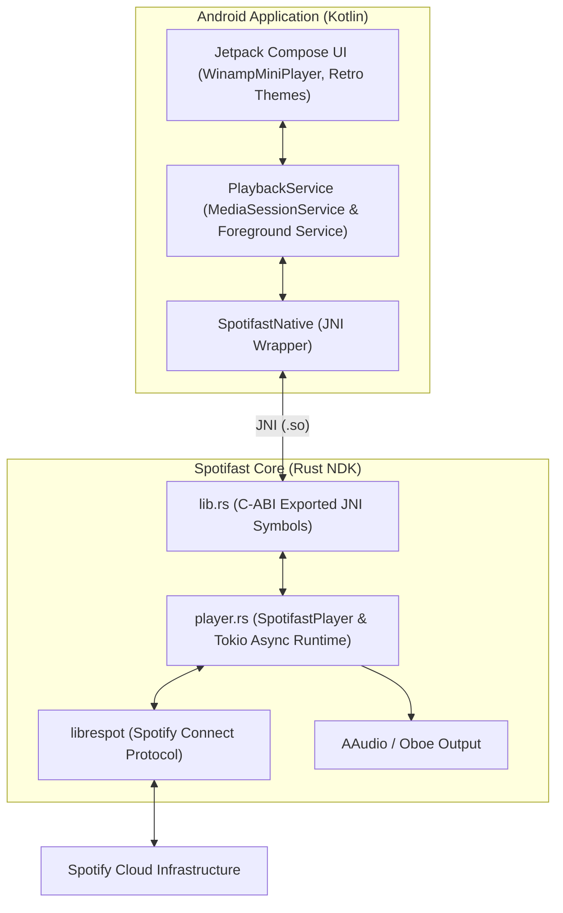

# Spotifast Android Port

[](https://github.com/arnoldmitre/spotifast-android/actions/workflows/build-apk.yml)

A lightweight mobile port of **Spotifast** for Android, featuring:
- **Rust Core (`librespot`):** Native Spotify Connect streaming engine compiled for `arm64-v8a` (`libspotifast_core.so`).
- **Retro Winamp Interface:** Mobile-optimized green LCD display, hardware-style tactile controls, and vintage stereo status indicators built with **Jetpack Compose**.
- **Android Background Media Service:** Full integration with AndroidX `MediaSessionService` for uninterrupted lock-screen controls, notification shade widgets, and Bluetooth metadata.

---

## Architecture



---

## Upstream References & Attributions

This project builds upon the foundational work of the following open-source projects:

1. **[Spotifast (Fastpotify)](https://github.com/crmne/spotifast) by `@crmne`:**
   * The original, ultra-lightweight desktop Spotify player written in Rust with Winamp nostalgia and low resource consumption.
2. **[librespot](https://github.com/librespot-org/librespot):**
   * The open-source Spotify client library written in Rust that reverse-engineers the Spotify Connect protocol.
3. **[Jetispot](https://github.com/BobbyESP/Jetispot) (by `@iTaysonLab` & `@BobbyESP`):**
   * The pioneer open-source Android client integrating `librespot` with Jetpack Compose.
4. **[Myspoti](https://github.com/kota-zo/myspoti) by `@kota-zo`:**
   * Architecture and design reference for modern Android Spotify interfaces in Jetpack Compose.

---

## Repository Structure

* **`core-rust/`**: The Rust backend compiled into `libspotifast_core.so`.
  * `src/lib.rs`: JNI bindings for `SpotifastNative.kt`.
  * `src/player.rs`: Async audio playback state manager and `librespot` session wrapper.
  * `Cargo.toml`: Configured for Android NDK `cdylib` targets.
* **`app/`**: The Android application project.
  * `src/main/jniLibs/arm64-v8a/`: Contains the pre-compiled `libspotifast_core.so` (1.1 MB).
  * `src/main/java/com/spotifast/android/MainActivity.kt`: Compose UI entry point.
  * `src/main/java/com/spotifast/android/SpotifastNative.kt`: Kotlin JNI bridge.
  * `src/main/java/com/spotifast/android/service/PlaybackService.kt`: `MediaSessionService` implementation.
  * `src/main/java/com/spotifast/android/ui/components/WinampPlayer.kt`: Winamp mini-player component.
* **`.github/workflows/build-apk.yml`**: Automated CI pipeline that builds and publishes debug APK artifacts on push.

---

## Building

### Automated Cloud Build (GitHub Actions)
Pushing to `main` automatically triggers the GitHub Actions workflow, compiling the APK and publishing it as a downloadable build artifact under the **Actions** tab.

### Local Build
1. **Recompile the Rust Core (Optional if using bundled `.so`):**
   ```bash
   cd core-rust
   cargo build --release
   cp target/release/libspotifast_core.so ../app/src/main/jniLibs/arm64-v8a/
   ```

2. **Assemble the APK:**
   ```bash
   ./gradlew assembleDebug
   ```
   The APK will be generated at `app/build/outputs/apk/debug/app-debug.apk`.
